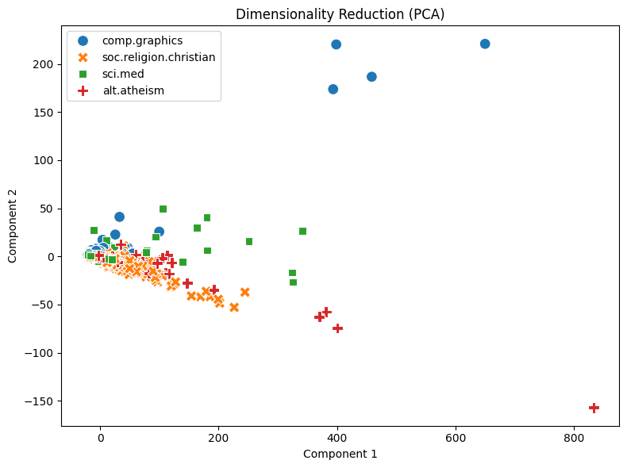

# Your report

I analyzed 2,257 newsgroup posts across four categories (`load_dataset_1`). There were no missing texts or duplicates (`check_missing_3`, `check_duplicates_4`). The median text length was 1,235 characters, but the mean was higher at 1,992.96, showing that some long posts pulled the average up (`describe_data_5`).

The DTM contained 35,788 terms and was 99.547% sparse (`dtm_6`). Common words like “the” and “of” appeared most often (`term_freq_7`). With a variance threshold of 0.01, 5,354 terms were flagged to keep, though this didn't change the DTM (`variance_filter_9`). Since common words still remained, high variance doesn't always point to useful topic information.

For sci.med, names and handles like “gordon” and “geb” showed up among the strongest Pearson correlations (`pearson_filter_10`). This suggests that headers and signatures influenced the results. Pattern mining with TF-IDF filtering and a minimum support of 100 found 1,949 patterns (`patterns_12`). The preview included header words like “subject” and “organization,” so these patterns shouldn't automatically be treated as medical topics.

A two-component PCA explained about 70.27% of the variance (`reduction_13`), and I also one-hot encoded the four categories (`binarize_labels_14`). Documents 0 and 1 had a cosine similarity of 0.3532 (`cosine_similarity_15`). Even though both belonged to comp.graphics, their wording wasn't all that similar.

