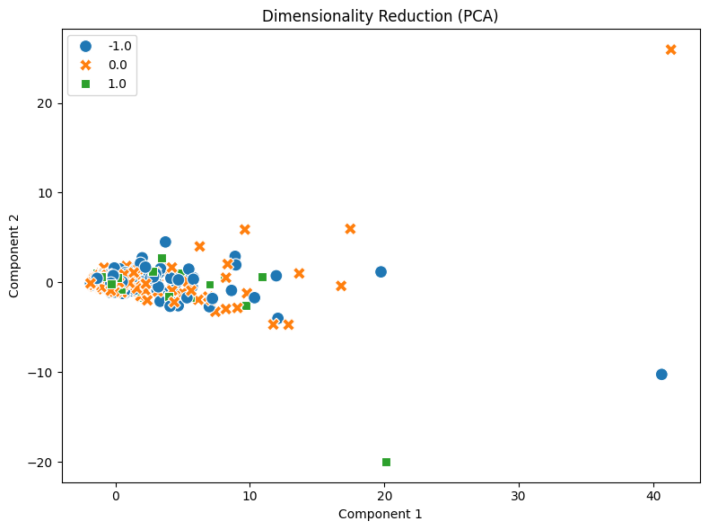

# Your report

I analyzed 847 Reddit posts labeled as negative, neutral, or positive. Most were neutral, with only 109 positive ones (`load_dataset_1`). There were no missing texts, but I found 23 duplicates (`check_missing_3`, `check_duplicates_4`). I kept them, though repeated posts might affect the word counts and other results. With a median length of 78 characters, the texts were much shorter than those in the newsgroups dataset (`describe_data_5`).

In the first DTM run, setting max_df=1 excluded words appearing in more than one document. Changing this to max_df=847 fixed the issue. The final matrix contained 4,346 terms and was 99.53% sparse (`dtm_8`). Common words like “the” and “to” appeared most frequently (`term_freq_9`). The variance filter flagged 506 terms to keep at a 0.01 threshold, but didn't alter the DTM (`variance_filter_11`).

Next, I looked at which words were linked to positive posts. Words like “nice” and “potential” were among the top terms, though the correlations were fairly weak, around 0.13 to 0.16 (`pearson_filter_12`). Pattern mining with TF-IDF filtering and a minimum support of 20 returned no patterns (`patterns_14`). This means none met the threshold across the 109 positive posts, not that no patterns exist.

A two-component PCA explained about 31.99% of the variance, so the plot only captures part of the differences between the documents (`reduction_15`). I also one-hot encoded the three sentiment labels (`binarize_labels_16`). Finally, documents 1 and 2 had a cosine similarity of 0.2004 (`cosine_similarity_17`). While both were neutral, their wording wasn't very similar.

